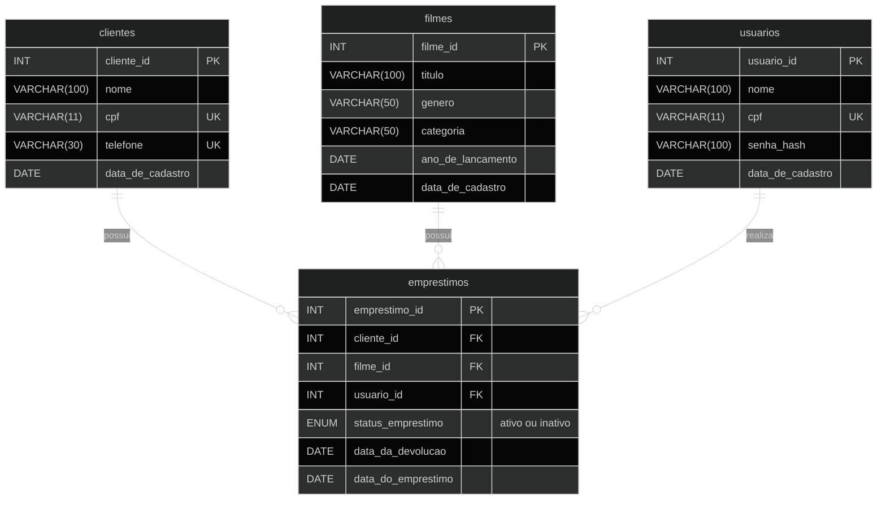

# Banco de dados — Locadora

Modelo com quatro tabelas. O usuário responsável fica registrado em cada empréstimo

## Diagrama de entidade-relacionamento



## Relacionamentos

| Relacionamento | Cardinalidade | Descrição |
| --- | --- | --- |
| Clientes → Empréstimos | 1:N | Um cliente pode ter zero ou vários empréstimos. Cada empréstimo pertence obrigatoriamente a um único cliente. |
| Filmes → Empréstimos | 1:N | Um filme pode aparecer em zero ou vários empréstimos ao longo do tempo. Cada empréstimo registra obrigatoriamente um único filme. |
| Usuários → Empréstimos | 1:N | Um usuário pode registrar zero ou vários empréstimos. Cada empréstimo possui obrigatoriamente um único usuário responsável. |

Os clientes são as pessoas que alugam os filmes. Os usuários são os operadores do sistema que registram os empréstimos.

**Legenda:** `PK` é chave primária; `FK` é chave estrangeira; `UK` indica valor único. No diagrama, `||` representa exatamente um e `o{` representa zero ou muitos.

## Código SQL

```sql
CREATE DATABASE IF NOT EXISTS locadora;
USE locadora;

CREATE TABLE usuarios (
    usuario_id INT AUTO_INCREMENT,
    nome VARCHAR(100) NOT NULL,
    cpf VARCHAR(11) NOT NULL,
    senha_hash VARCHAR(100) NOT NULL,
    data_de_cadastro DATE DEFAULT (CURRENT_DATE),

    PRIMARY KEY (usuario_id),
    UNIQUE (cpf)
);

CREATE TABLE clientes (
    cliente_id INT AUTO_INCREMENT,
    nome VARCHAR(100) NOT NULL,
    cpf VARCHAR(11) NOT NULL,
    telefone VARCHAR(30) NOT NULL,
    data_de_cadastro DATE DEFAULT (CURRENT_DATE),

    PRIMARY KEY (cliente_id),
    UNIQUE (cpf),
    UNIQUE (telefone)
);

CREATE TABLE filmes (
    filme_id INT AUTO_INCREMENT,
    titulo VARCHAR(100) NOT NULL,
    genero VARCHAR(50) NOT NULL,
    categoria VARCHAR(50) NOT NULL,
    ano_de_lancamento DATE NOT NULL,
    data_de_cadastro DATE DEFAULT (CURRENT_DATE),

    PRIMARY KEY (filme_id)
);

CREATE TABLE emprestimos (
    emprestimo_id INT AUTO_INCREMENT,
    cliente_id INT NOT NULL,
    filme_id INT NOT NULL,
    usuario_id INT NOT NULL,
    status_emprestimo ENUM('ativo', 'inativo'),
    data_da_devolucao DATE,
    data_do_emprestimo DATE DEFAULT (CURRENT_DATE),

    PRIMARY KEY (emprestimo_id),
    FOREIGN KEY (cliente_id)
        REFERENCES clientes (cliente_id),
    FOREIGN KEY (filme_id)
        REFERENCES filmes (filme_id),
    FOREIGN KEY (usuario_id)
        REFERENCES usuarios (usuario_id)
);
```

